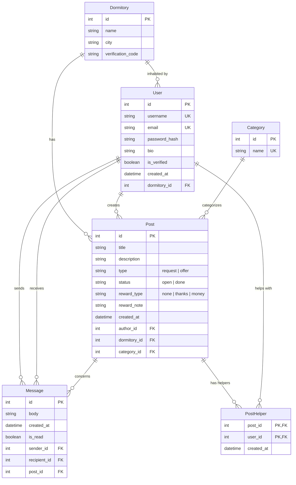

[← Documentation Home](README.md)

# Data Model

## Overview

Für StudyNet werden Wohnheime, Bewohner\*Innen, Beiträge (Hilfegesuche und -angebote), Kategorien, Helfenden-Zusagen und Privatnachrichten gespeichert.
Jede Person gehört zu genau einem Wohnheim. Beiträge, Hilfe und Nachrichten finden innerhalb dieses Wohnheims statt.
Die beiden Nutzendengruppen – **Hilfesuchende** und **Hilfsbereite** – sind keine getrennten Rollen, sondern dieselbe Entität `User`. Welche Rolle jemand einnimmt, ergibt sich aus der Interaktion. Wer einen Beitrag erstellt, ist Autor\*in, wer bei einem Beitrag hilft, wird als Helfer\*in erfasst. Dieselbe Person kann also in einem Beitrag Hilfe suchen und in einem anderen Hilfe anbieten.

## Entity-Relationship Diagram

## Entities and Relationships

**Dormitory** grenzt die Plattform ab. Nutzer*innen sehen nur Beiträge aus ihrem eigenen Wohnheim. Der `verification_code` dient der Identitätsprüfung, wer bei der Registrierung den richtigen Code seines Wohnheims eingibt, wird als verifiziert markiert (`is_verified`).

**Post** bildet Angebot und Nachfrage in einer Entität ab. Über `type` wird unterschieden, ob jemand Hilfe sucht (`request`) oder anbietet (`offer`). Ob und wie eine Gegenleistung erwartet wird, beschreiben `reward_type` und `reward_note`. Mit `status` markiert die Autor*in, ob der Beitrag noch offen oder erledigt ist.

`Post.dormitory_id` ist bewusst zusätzlich zur Wohnheim-Zuordnung über die Autor\*in gespeichert. So bleibt ein Beitrag dem Wohnheim zugeordnet, in dem er erstellt wurde, auch wenn die Autor*in später umzieht.

**Category** ordnet Beiträge thematisch ein (z. B. Nachhilfe, Fundsachen, Tools & Skills) und ermöglicht das Filtern und Durchsuchen.

**PostHelper** (siehe [design decision](design-decisions/dd-01.md) ) Sagt jemand bei einem Beitrag Hilfe zu, entsteht hier ein Eintrag. Ein Beitrag kann mehrere Helfer\*innen haben, und eine Person kann bei mehreren Beiträgen helfen. Der zusammengesetzte Primärschlüssel verhindert, dass dieselbe Person sich zweimal für denselben Beitrag meldet.

**Message** ermöglicht private Absprachen zwischen zwei Nutzer\*innen. Jede Nachricht bezieht sich auf einen Beitrag, sodass Gespräche immer einem konkreten Anliegen zugeordnet sind. Ein Chatverlauf ergibt sich aus allen Nachrichten zwischen zwei Personen zu einem Beitrag.

## Related Design Decisions

- [01: Speicherung der post_helper in der DB](design-decisions/dd-01.md)

