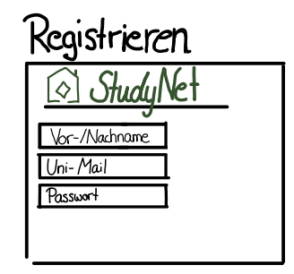
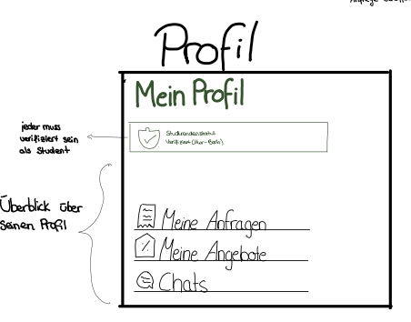

# StudyNet

> StudyNet ist eine Webplattform für Studierende in Wohnheimen, die gegenseitige Alltagshilfe und soziale Vernetzung erleichtert. Nutzer\*Innen können Hilfe suchen und anbieten, verlorene Gegenstände melden und direkt miteinander in Kontakt treten.

## Documentation Contents

- [Value Proposition](01-value-proposition.md)
- [Data Model](02-data-model.md)
- [Design Decisions](design-decisions/README.md)
- [Product Discovery](product-discovery/README.md)
- [Contributors](contributors/README.md)

---

## Refinements since Submission

[List (a) which refinements or improvements you have promised during Oral Examination and (b) to which extent you managed to implement them with the Refined Submission (and reasons for deviations, if any).]