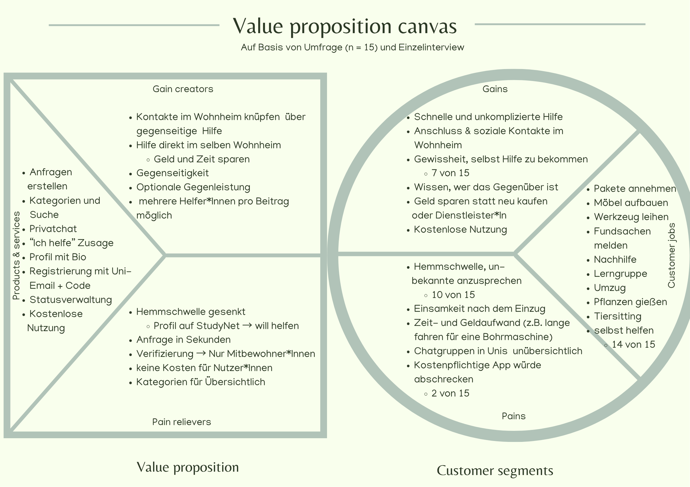

[← Product Discovery](README.md)

# Solution Elements

## Lösungsansätze für die identifizierten Probleme

Aus der Umfrage und dem Inteview haben wir die zentralen Probleme abgeleitet und jeweils ein Lösungselement zugeordnet.

| Problem (aus Users + Problems) | Lösungselement in StudyNet |
| --- | --- |
| 10 von 15 befragten Personen ist es unangenehm, Unbekannte im Wohnheim um Hilfe zu bitten | Anfragen werden öffentlich im eigenen Wohnheim gepostet statt an fremden Türen zu klingeln. Teilnahme bei StudyNet impliziert Hilfsbereitschaft. |
| Hilfe soll schnell und unkompliziert sein ("wie eine Whatsapp Nachricht" ) | Kurzes Formular für Anfragen: Typ (suchen/anbieten), Titel, Kategorie, optional Beschreibung |
| Man möchte direkt Kontakt aufnehmen können | Privatchat direkt möglich |
| Man möchte wissen, mit wem man gerade in Kontakt ist | Registrierung nur mit Uni Mail möglich |
| Häufig auftretende Bereiche: Pakete, Möbel, Fundsachen, Nachhilfe, Haustiere | untergeordnet nach Kategorien |
| Die meisten wollen keine Bezahlung, zwei würden eine kostenpflichtige App nicht nutzen | Plattform kostenlos, Gegenleistung ist optional, möglich ist keine, ein dankeschön oder eine kleine Aufmerksamkeit |

## Value Proposition Canvas

